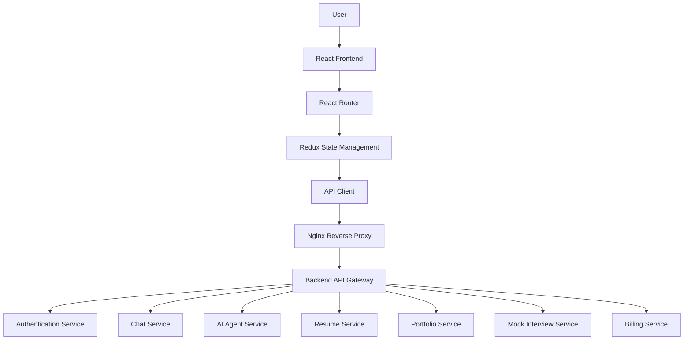

# SOLVIX — AI-Powered Productivity & Career Ecosystem

<div align="center">

**One Workspace. Endless Possibilities.**

A unified AI-powered platform designed to simplify productivity, career development, learning, and intelligent automation through specialized AI agents.

</div>

---

## Overview

SOLVIX is a modern AI-powered productivity and career ecosystem that brings multiple intelligent tools together in a single workspace. Built with React, Vite, and modern frontend technologies, SOLVIX provides an intuitive interface for interacting with AI agents, managing conversations, generating professional documents, exploring career opportunities, and accessing AI-powered productivity tools.

The frontend is designed as a responsive, scalable, and modular application that integrates seamlessly with SOLVIX's backend microservices architecture.

SOLVIX combines Generative AI, Agentic AI, Retrieval-Augmented Generation (RAG), automation, and career-focused tools to create an intelligent workspace for students, developers, professionals, and creators.

---

## Features

### AI Chat Workspace

- Interactive AI chat interface.
- Persistent conversations and chat history.
- Multiple specialized AI agents.
- AI-powered coding assistance.
- Web search integration.
- File-based AI interactions.
- Context-aware conversations.
- Markdown rendering for AI responses.
- Syntax highlighting for code.
- Copy response and code functionality.
- Responsive chat interface.

### AI Agent Ecosystem

Interact with specialized AI agents designed for different use cases.

- General AI Assistant
- Coding Assistant
- Research Assistant
- Career Assistant
- Educational Assistant
- Custom AI Agents

### AI Resume Builder

Create professional resumes using AI.

- AI-powered resume generation.
- Resume content editing.
- Professional resume templates.
- Resume analysis and improvement.
- ATS-focused optimization.
- PDF export and document generation.

### Resume Analyzer

Analyze resumes and receive intelligent feedback.

- Resume evaluation.
- ATS compatibility analysis.
- Skills analysis.
- Professional recommendations.
- Resume improvement suggestions.

### AI Portfolio Builder

Transform professional information and resumes into personalized portfolios.

- AI-powered portfolio generation.
- Portfolio customization.
- Professional profile generation.
- Portfolio publishing.
- Shareable portfolio links.

### AI Mock Interview

Prepare for interviews using AI-powered interview simulations.

- AI-generated interview questions.
- Interactive interview sessions.
- Technical interview practice.
- Interview feedback.
- Performance evaluation.
- Personalized improvement recommendations.

### AI Job Finder

Discover career opportunities using AI-powered job search functionality.

- Job discovery.
- AI-powered job recommendations.
- Job information and analysis.
- Career-related assistance.
- Automated job application workflows.

### AI Learning Roadmaps

Generate structured learning roadmaps for different technologies and career paths.

- Personalized learning plans.
- Beginner to advanced learning paths.
- Roadmap phases.
- Learning resources.
- Structured progression.

### Custom AI Agent Builder

Create and configure personalized AI agents.

- Custom agent creation.
- Agent configuration.
- Model selection.
- Temperature configuration.
- Custom agent instructions.
- Specialized AI workflows.

### AI Content Generation

Generate and interact with AI-powered content.

- Text generation.
- Code generation.
- Document generation.
- AI-powered presentations.
- Image generation.
- AI-powered file processing.

### Billing & Credits

Manage usage and subscription plans.

- Credit-based usage system.
- Subscription plans.
- Credit balance.
- Payment integration.
- Billing history and account information.

### Admin Dashboard

Administrative interface for managing the platform.

- Platform analytics.
- User management.
- System monitoring.
- Subscription management.
- Usage analytics.

---

## Technology Stack

### Frontend

| Technology | Purpose |
|---|---|
| React 19 | UI development |
| Vite | Development server and build tooling |
| JavaScript | Application logic |
| Tailwind CSS 4 | Styling |
| Redux | Global state management |
| React Router | Client-side navigation |
| Axios | API communication |
| React Icons | Icon library |
| React Markdown | Markdown rendering |
| Syntax Highlighting | Code presentation |

### Infrastructure

| Technology | Purpose |
|---|---|
| Docker | Containerization |
| Docker Compose | Container orchestration |
| Nginx | Production web server |
| Git | Version control |
| GitHub | Source code management |

### Backend Integration

The frontend communicates with the SOLVIX backend architecture, including:

- API Gateway
- Authentication Service
- Chat Service
- AI Agent Service
- Resume Service
- Portfolio Service
- Mock Interview Service
- Billing Service

---

## Architecture



The frontend provides a unified user interface while the backend handles AI processing, authentication, database operations, payment processing, and business logic.

---

## Project Structure

```text
frontend/
│
├── public/
│   ├── assets/
│   ├── images/
│   └── favicon/
│
├── src/
│   ├── assets/
│   │
│   ├── components/
│   │   ├── common/
│   │   ├── layout/
│   │   ├── chat/
│   │   ├── agents/
│   │   └── ui/
│   │
│   ├── pages/
│   │   ├── Home/
│   │   ├── Chat/
│   │   ├── Resume/
│   │   ├── Portfolio/
│   │   ├── Interview/
│   │   ├── Jobs/
│   │   ├── Roadmap/
│   │   ├── Billing/
│   │   └── Settings/
│   │
│   ├── redux/
│   │   ├── store.js
│   │   └── slices/
│   │
│   ├── services/
│   │   ├── api.js
│   │   └── auth.js
│   │
│   ├── hooks/
│   │
│   ├── utils/
│   │
│   ├── routes/
│   │
│   ├── App.jsx
│   └── main.jsx
│
├── .env.production
├── .gitignore
├── Dockerfile
├── nginx.conf
├── package.json
├── package-lock.json
└── README.md
```

---

## Getting Started

### Prerequisites

Make sure the following tools are installed:

- Node.js 20+
- npm
- Git
- Docker
- Docker Compose

---

## Installation

### 1. Clone the Repository

```bash
git clone https://github.com/SirajAbid17/Solvix.git
```

### 2. Navigate to the Frontend

```bash
cd Solvix/frontend
```

### 3. Install Dependencies

```bash
npm install
```

### 4. Configure Environment Variables

Create an environment file if required by your frontend configuration.

```env
VITE_API_URL=http://localhost:5000
```

Configure the API URL according to your backend and deployment environment.

> Never expose private API keys, database credentials, JWT secrets, Stripe secret keys, or other sensitive backend credentials through frontend environment variables.

---

## Development

Start the Vite development server:

```bash
npm run dev
```

The frontend development server will be available at:

```text
http://localhost:5173
```

The development server supports Hot Module Replacement (HMR), allowing changes to the frontend code to appear instantly without manually restarting the application.

---

## Production Build

Generate an optimized production build:

```bash
npm run build
```

The generated production files will be located inside:

```text
dist/
```

Preview the production build locally:

```bash
npm run preview
```

---

## Docker Deployment

SOLVIX frontend is containerized using Docker and served through Nginx.

### Build Docker Image

```bash
docker build -t solvix-frontend .
```

### Run Docker Container

```bash
docker run -d \
  --name solvix-frontend \
  -p 80:80 \
  solvix-frontend
```

The application will be accessible at:

```text
http://localhost/
```

### Docker Compose

The frontend can also be deployed using the SOLVIX Docker Compose configuration.

From the root directory of the project:

```bash
docker compose up -d --build frontend
```

Check the running container:

```bash
docker ps
```

View frontend logs:

```bash
docker logs solvix-frontend
```

Stop the frontend container:

```bash
docker compose stop frontend
```

Restart the frontend:

```bash
docker compose restart frontend
```

Rebuild and restart the frontend:

```bash
docker compose up -d --build frontend
```

---

## Application URLs

| Environment | URL |
|---|---|
| Development | `http://localhost:5173/` |
| Local Docker Production | `http://localhost/` |
| AWS EC2 Deployment | `http://YOUR_EC2_PUBLIC_IP/` |
| Production Domain | `https://your-domain.com/` |

---

## API Integration

SOLVIX frontend integrates with backend APIs through the API Gateway.

The API Gateway handles requests and routes them to the appropriate backend microservice.

```text
Frontend
   │
   ▼
API Gateway
   │
   ├── Authentication
   ├── Chat
   ├── AI Agents
   ├── Resume
   ├── Portfolio
   ├── Mock Interview
   └── Billing
```

API communication is managed through the application's API client and configured backend endpoints.

---

## Authentication

SOLVIX supports secure authentication workflows integrated with the backend authentication service.

Authentication features include:

- User registration.
- User login.
- Google authentication.
- JWT-based authentication.
- Secure cookie-based session handling.
- Protected routes.
- User profile management.
- Logout functionality.

The frontend communicates with the authentication service through the API Gateway.

---

## State Management

Redux is used to manage application-wide state.

State management includes:

- Authentication state.
- User profile.
- Chat conversations.
- AI agent configuration.
- Credits and billing.
- Application preferences.
- Global UI state.

Redux allows different components and pages to share application data efficiently.

---

## Responsive Design

SOLVIX is designed to provide a consistent experience across different devices.

The interface supports:

- Desktop computers.
- Laptops.
- Tablets.
- Mobile devices.

Responsive layouts ensure that the chat workspace, dashboards, navigation, and AI tools remain accessible across different screen sizes.

---

## Security Considerations

- Authentication is handled through the backend.
- Protected routes prevent unauthorized access to restricted pages.
- Sensitive credentials are not stored in frontend source code.
- Production environment files should not be committed to GitHub.
- API communication should use HTTPS in production.
- Backend services validate user requests and permissions.
- Secure cookie configuration is managed by the backend.
- Production deployments should use environment-specific configurations.

---

## Deployment

SOLVIX frontend can be deployed using Docker and Nginx.

### Local Deployment

```bash
docker compose up -d --build
```

### AWS EC2 Deployment

The frontend can be deployed to an AWS EC2 instance using Docker and Docker Compose.

Typical deployment workflow:

```text
GitHub Repository
        │
        ▼
AWS EC2 Instance
        │
        ▼
Docker Compose
        │
        ▼
SOLVIX Frontend Container
        │
        ▼
Nginx
        │
        ▼
Users
```

The production frontend can be accessed using the EC2 public IP or a configured domain name.

---

## Development Workflow

```text
1. Clone the Repository
2. Install Dependencies
3. Configure Environment Variables
4. Start Development Server
5. Develop Frontend Features
6. Test API Integration
7. Build Production Application
8. Build Docker Image
9. Deploy Using Docker Compose
```

---

## Available Scripts

| Command | Description |
|---|---|
| `npm install` | Install dependencies |
| `npm run dev` | Start development server |
| `npm run build` | Build production application |
| `npm run preview` | Preview production build |
| `npm run lint` | Run ESLint if configured |

---

## SOLVIX Ecosystem

SOLVIX is part of a unified AI productivity ecosystem built around specialized intelligent services.

| Module | Description |
|---|---|
| AI Chat | Conversational AI workspace |
| AI Agents | Specialized and custom agents |
| Resume Builder | AI-powered professional resume creation |
| Resume Analyzer | Resume evaluation and optimization |
| Portfolio Builder | AI-powered portfolio generation |
| Mock Interview | Interview simulation and feedback |
| Job Finder | Career opportunities and job assistance |
| AI Roadmap | Personalized learning roadmaps |
| Billing | Credit and subscription management |
| Admin Dashboard | Platform administration and analytics |

---

## Future Enhancements

- Enhanced AI agent collaboration.
- Advanced personalization.
- Improved mobile experience.
- Real-time collaborative AI workspaces.
- More AI integrations.
- Advanced analytics.
- Improved automation workflows.
- Additional career development tools.

---

## Contributing

Contributions, suggestions, and improvements are welcome.

To contribute:

1. Fork the repository.
2. Create a new branch.
3. Implement your changes.
4. Test your changes.
5. Submit a pull request.

---

## Author

**Siraj Abid**

Full Stack Developer & Generative AI Engineer

- GitHub: [SirajAbid17](https://github.com/SirajAbid17)
- LinkedIn: [Siraj Abid](https://linkedin.com/in/sirajabid17)

---

## License

This project is developed as an AI-powered productivity and career ecosystem.

Copyright © Siraj Abid.

---

<div align="center">

### SOLVIX

**One Workspace. Endless Possibilities.**

Built with ❤️ using React, Generative AI, and modern web technologies.

</div>
